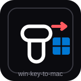

# win-key-to-mac

> Turn your Windows keyboard into a Mac-like one — with [AutoHotkey v2](https://www.autohotkey.com/).

<p align="center">
  
</p>

<p align="center">
  
  
  
</p>

`win-key-to-mac` remaps your Windows shortcuts to feel like **macOS** — without buying a Mac
keyboard. The Windows key takes over the role of the Mac **⌘ Command** key, so the muscle memory
you built on a Mac transfers straight to Windows.

---

## ✨ Features

| Layer | What it does | Default |
|-------|--------------|---------|
| **Caps → Ctrl** | Caps Lock becomes a Ctrl modifier (`Caps+C` → Copy); LED stays off, no more accidental caps. | ✅ on |
| **Win → Command** | Hold the Windows key to trigger Mac-style shortcuts (`Win+C` → Copy, `Win+Q` → Quit, `Win+Tab` → App switcher, …) | ✅ on |
| **SpaceFN** | Hold **Space** and tap `h/j/k/l` (or `d/g/e/n/u/i`) to move the cursor like a trackpad. A quick tap still types a space. | ✅ on |
| **Hyper key** | Hold **Tab** to get a dedicated `Ctrl+Shift+Alt+Win` modifier for your own macros. A quick tap still sends Tab. | ✅ on |
| **App launcher** | `Win+Space` opens Windows Search (Spotlight-like). Off by default so it doesn't steal the language switch. | ⚙️ off |

Everything is toggleable from a single config file and takes effect immediately after a reload —
no recompile needed.

---

## 📋 Requirements

- **Windows 10 / 11**
- **[AutoHotkey v2.0+](https://www.autohotkey.com/download/)** (v1 is **not** supported)

> Works great with a real Mac keyboard too: the physical ⌘ key is seen by Windows as the Windows
> key, so `⌘C` already lands on `Win+C`.

---

## 🚀 Installation

1. Install [AutoHotkey v2](https://www.autohotkey.com/download/).
2. Download / clone this repo.
3. **Double-click `win-key-to-mac.ahk`** — the script starts in your tray.
4. (Optional) Right-click the tray icon → **Reload** after editing settings.

To make it run at login, drop a shortcut to `win-key-to-mac.ahk` into your
`%APPDATA%\Microsoft\Windows\Start Menu\Programs\Startup` folder.

---

## ⚙️ Configuration

Open **`config/settings.ahk`** and flip any switch:

```ahk
EnableCapsToCtrl   := true    ; Caps Lock = Ctrl modifier (LED off)
EnableWinToCommand := true    ; Windows key → Mac shortcuts
EnableSpaceFN       := true   ; Hold Space = navigation layer
EnableHyperKey      := true   ; Hold Tab    = Hyper key
EnableAppLauncher   := false  ; Win + Space = Windows Search
MapWinTabToAltTab   := true   ; Win + Tab  = Mac-style app switcher
```

Save, then **Reload** (tray icon, or `Ctrl + Win + R`).

---

## 🗺️ Keymap reference

See **[docs/keymap.md](docs/keymap.md)** for the full table of every mapping.

A few highlights:

| Windows key combo | Result (Mac-style) |
|-------------------|--------------------|
| `Caps + A / C / X / V / Z` | Select All / Copy / Cut / Paste / Undo (Caps acts as Ctrl) |
| `Win + A / C / X / V / Z` | Select All / Copy / Cut / Paste / Undo |
| `Win + Q` | Quit app (`Alt+F4`) |
| `Win + W` | Close tab / window |
| `Win + S` | Save |
| `Win + [ / ]` | Previous / Next tab |
| `Win + Backspace` | Delete previous word |
| `Win + Tab` | App switcher (like `Cmd + Tab`) |
| `Space` + `h/j/k/l` | Left / Down / Up / Right |

---

## 📁 Project structure

```
win-key-to-mac/
├── win-key-to-mac.ahk     # Entry point — run this
├── config/
│   └── settings.ahk       # Your toggles & tweaks
├── lib/
│   ├── caps-to-ctrl.ahk   # Caps Lock → Ctrl modifier
│   ├── win-to-command.ahk # Win key → Mac shortcuts
│   ├── spacefn.ahk        # SpaceFN navigation layer
│   ├── hyper-key.ahk      # Tab → Hyper key
│   └── app-launcher.ahk   # Optional app launcher
├── docs/
│   ├── keymap.md          # Full keymap reference
│   └── faq.md             # Troubleshooting & FAQ
├── assets/
│   └── logo.svg
├── tools/
│   └── setup-repo.ps1     # One-click GitHub publish (see below)
├── LICENSE
└── CHANGELOG.md
```

---

## 🌐 Publish to GitHub

This repo ships with a helper that initializes git and creates the GitHub project for you:

```powershell
# From inside the win-key-to-mac/ folder, in PowerShell:
./tools/setup-repo.ps1
```

It requires [`git`](https://git-scm.com/) and the
[GitHub CLI (`gh`)](https://cli.github.com/) to be installed and `gh` authenticated
(`gh auth login`). If `gh` isn't set up, the script falls back to printing the manual commands.

**Manual steps:**

```bash
git init
git add .
git commit -m "Initial commit: win-key-to-mac v1.0.0"
gh repo create win-key-to-mac --public --source=. --remote=origin --push
# or, if you created the repo on github.com first:
git remote add origin https://github.com/<you>/win-key-to-mac.git
git branch -M main
git push -u origin main
```

---

## 🤝 Contributing

Pull requests are welcome! Add mappings in the relevant `lib/*.ahk` file, document them in
`docs/keymap.md`, and note the change in `CHANGELOG.md`.

---

## 📄 License

[MIT](LICENSE) © 2026 luosk
